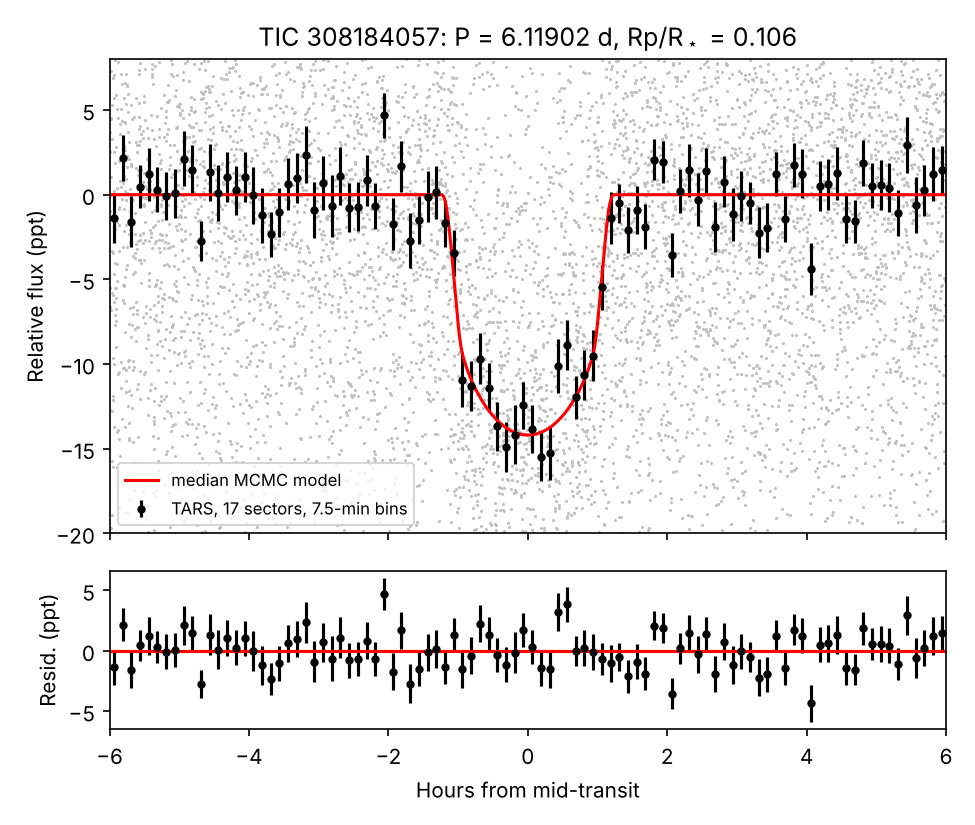
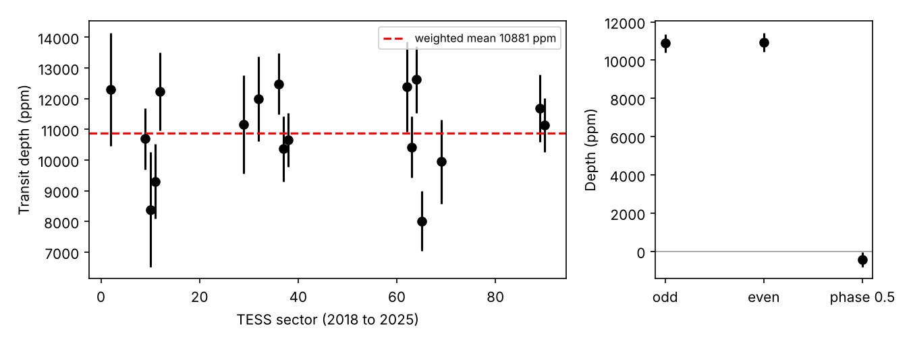
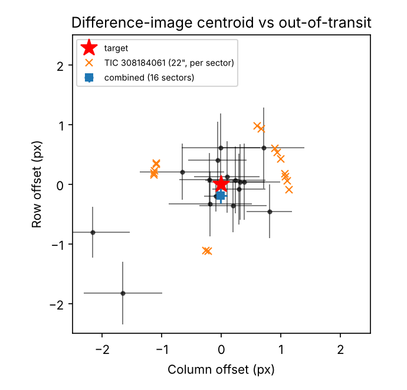

# Abstract

We report a periodic transit-like signal on TIC 308184057, a K dwarf with T = 14.50, Teff ≈ 4340 K, R★ ≈ 0.73 R☉, at 424 pc. The signal was found in a blind search of 8,783 dwarfs with T = 13.5–15.5 in TGLC full-frame-image (FFI) light curves. These stars are fainter than the T = 13.5 limit of the Quick-Look Pipeline (QLP).

We confirmed the signal in independent TARS FFI photometry covering 17 TESS sectors between 2018 and 2025:

- **Period and depth.** P = 6.1190153 ± 0.0000064 d, with a transit depth of ≈ 1.1% (Rp/R★ = 0.106 ± 0.003) and a duration of T14 = 2.40 (+0.08/−0.06) h.
- **Size.** This implies Rp ≈ 0.76 ± 0.06 R_J if the signal arises on the target.
- **Consistency.** The depth is the same in every sector. Odd and even depths agree within 0.1σ, and there is no secondary eclipse (−429 ± 385 ppm).
- **Location.** Stacked difference imaging in 16 sectors puts the source of the flux loss on the target, at 1.6σ. The nearest neighbour bright enough to mimic the signal (TIC 308184061, 22″ away) is disfavoured by Δχ² = 76.
- **Gaia.** The target has RUWE = 0.95, and no other Gaia DR3 source lies within 19.9″.
- **Not previously reported.** The star has no TOI or CTOI on ExoFOP (checked 2026-11-06), no entry in the NASA Exoplanet Archive within 60″, and no entry in the TESS eclipsing-binary catalogue or the other public amateur candidate lists we checked.
- **False-positive probability.** TRICERATOPS gives FPP = 0.19 and NFPP = 0.17, so the signal is a "likely planet", not a validated one. Almost all of the false-positive probability comes from nearby-star scenarios that our pixel analysis disfavours. Removing them gives FPP ≈ 0.03; this second number is our own analysis, not the standard TRICERATOPS output.

The transit-derived stellar density, 4.6 (+0.7/−1.0) g cm⁻³, is ≈ 2σ above the TIC value of 2.5 g cm⁻³. This may point to orbital eccentricity, an overestimated stellar radius, or a blend.

**We do not claim a planet.** We report the signal as a planet candidate and provide an ephemeris for ground-based photometry, high-resolution imaging and radial-velocity follow-up. A ~0.8 R_J companion to a 0.68 M☉ star would produce K ≈ 100–130 m s⁻¹ if its mass is near 1 M_J.

# 1. Introduction

The TESS Quick-Look Pipeline searches FFI light curves to T = 13.5, and most community searches use QLP or SPOC products. Stars fainter than that limit, and without 2-min data, have received far less attention. Giant planets still produce detectable ~1% transits around such stars.

Recent PSF-based FFI photometry makes these stars searchable with modest computing resources. Examples are TESS-Gaia Light Curves (TGLC) and the TARS high-level science product. We ran such a search, as part of an independent project using public data only, and report its strongest surviving signal.

# 2. Data

- **Search data.** TGLC light curves (calibrated PSF flux, cadences flagged by TESS or TGLC removed) from Sectors 2, 9, 10 and 11 (30-min cadence), retrieved from MAST.
- **Confirmation data.** TARS FFI light curves for Sectors 2, 9–12 (30 min), 29, 32, 36–38 (10 min), and 62–65, 69, 89, 90 (200 s), retrieved from MAST.
  - Each sector is normalised by its median.
  - Each light curve is detrended with a biweight filter (wotan, 0.75-d window) **with the transits masked**. Without the mask, the filter pulls in the transit wings and biases the out-of-transit baseline by about 1–2 ppt.
- **Catalogues.**
  - TIC v8 for stellar parameters and neighbours.
  - Gaia DR3 for RUWE and IPD multi-peak statistics, within 1′ of the target.
  - NASA Exoplanet Archive pscomppars and TOI tables (2026-11-06).
  - The ExoFOP target page (2026-11-06).
  - A public TESS eclipsing-binary list.
  - A public TOI/CTOI/KOI id list.
  - The eumemic/exoplanets public signal lists.

# 3. Search and detection

The search sample is 8,783 southern (ecliptic latitude < −15°) dwarfs with Teff = 3800–6200 K, R★ = 0.4–1.3 R☉ and T = 13.5–15.5. Stars that are already TOI, CTOI, KOI or confirmed-planet hosts, or are catalogued eclipsing binaries, were excluded before the search.

**Pipeline** (`tglc_search.py`):

1. Rotation prewhitening.
2. Biweight detrending.
3. A box least-squares search over P = 0.5–13 d with durations of 1–6 h.

**Frozen candidate thresholds**, set before the search was run: SNR ≥ 10, SDE ≥ 9, ≥ 2 transits, depth 0.3–5%, odd/even < 3σ, secondary < 3σ, and a duration consistent with the stellar density.

**Completeness and false alarms.** In injection–recovery tests on 114 real light curves, the pipeline recovered 22% of injected 0.5–1.5% giants with P = 1–8 d. The false-alarm rate on uninjected light curves was 0.9%.

**Results.** 42 stars passed. A second, frozen filter (`tglc_vet.py`) requires a flat out-of-transit fold at P and at 2P, and directly measured odd/even depths that agree. Thirty-seven of the 42 failed it; most were contact binaries, pulsators and short-period EBs.

TIC 308184057 survived with P = 6.119 d, SNR 17 and SDE 16. It is the only survivor that is consistent across 17 sectors of independent photometry.

# 4. Vetting

| Test | Result |
|---|---|
| Multi-year consistency (TARS, 17 sectors, 2018–2025) | transit present in every sector; weighted mean depth 10,880 ppm; scatter consistent with the errors (Fig. 2) |
| Odd/even depth | 10,879 ± 471 vs 10,935 ± 495 ppm (0.1σ) |
| Secondary eclipse at phase 0.5 | −429 ± 385 ppm (none) |
| Out-of-transit flatness at P and 2P (TGLC) | χ²/dof = 0.68 and 0.57 (no ellipsoidal or reflection signal) |
| Difference-image centroid (TESScut, 16 sectors) | offset (−0.02 ± 0.11, −0.20 ± 0.12) px from the target, 1.6σ (Fig. 3) |
| Nearest capable neighbour (TIC 308184061, G = 16.4, 22″) | would need a ~4.6% eclipse; disfavoured by Δχ² = 76 relative to the target |
| Gaia DR3 (target) | RUWE 0.953, ipd_frac_multi_peak 0, non_single_star 0; no source within 19.9″ |
| Catalogue and duplicate checks | none in the TOI, CTOI, NASA planet (60″ cone), TESS EB or public amateur lists; ExoFOP: 0 TOIs, 0 CTOIs, no follow-up |

# 5. Transit model

We fit all 17 sectors jointly with batman and emcee (40 walkers, 6,000 steps, 2,000 discarded as burn-in).

- **Free parameters:** T0, P, Rp/R★, b, ρ★, the quadratic limb-darkening coefficients (Kipping q1 and q2), a baseline offset, and one jitter term per cadence group.
- **Cadence handling:** each cadence was supersampled.
- **Orbit:** assumed circular.

| Parameter | Value |
|---|---|
| T0 (BTJD = BJD − 2457000) | 3051.21884 ± 0.00080 |
| P (d) | 6.1190153 ± 0.0000064 |
| Rp/R★ | 0.1064 (+0.0031/−0.0033) |
| b | 0.24 (+0.20/−0.17) |
| ρ★ (g cm⁻³), transit-derived | 4.6 (+0.7/−1.0) (TIC: 2.5) |
| a/R★ | 21.0 (+0.9/−1.6) |
| i (deg) | 89.3 (+0.5/−0.6) |
| T14 (h) | 2.40 (+0.08/−0.06) |
| Rp (R_J), for R★ = 0.73 ± 0.05 R☉ | 0.76 ± 0.06 |

Absolute depths differ slightly between photometry pipelines (TGLC ≈ 1.6%, TARS ≈ 1.1–1.25%). This most likely reflects differences in background and dilution treatment.

# 6. Statistical validation

We ran TRICERATOPS v1.1.0 on the TARS 200-s data (Sectors 62–65, 69, 89, 90) with 3×3-pixel apertures and 10⁶ draws.

**Adaptations for our network-restricted environment** (the method is unchanged):

1. The field-star population was built from TIC/Gaia DR2 photometry and parallaxes instead of a Gaia DR3 TAP query.
2. The star was looked up by coordinates.
3. TESScut cutouts were retrieved directly.
4. The physical-pixel offset was set to zero. Apertures were defined in TRICERATOPS' own pixel frame.

| Sectors | FPP | NFPP |
|---|---|---|
| 62–65, 69, 89, 90 (all) | 0.19 | 0.17 |
| 62–65 | 0.36 | 0.32 |
| 69, 89, 90 | 0.55 | 0.51 |

**Interpretation.**

- On the full data set the probability of a planet on the target is 0.81 (TP 0.64, PTP 0.16).
- The false-positive probability is dominated by nearby-star scenarios: NEB 0.13 and NTP 0.04.
- The subset results are consistent within a factor of ≈ 3, and the full data set is the most constraining. We see no sign of a pathological setup.
- **If all neighbours ≥ 0.95 px away are excluded, as our difference imaging supports, the FPP falls to ≈ 0.03.** The remaining false-positive scenarios are an eclipsing binary or a planet on an unresolved companion of the target (SEB and STP, about 0.015 each). This adjusted value is our own analysis and is not a standard TRICERATOPS output.
- High-resolution imaging, providing a contrast curve, is needed before the standard validation thresholds (FPP < 0.015, NFPP < 0.001) can be reached.

# 7. Discussion

**Nature of the companion.** A radius of ≈ 0.76 R_J is consistent with a sub-Saturn or Saturn-mass planet, but also with a brown dwarf or a very low-mass star. Only a radial-velocity mass can separate these. The absence of a secondary eclipse (< ~800 ppm at 2σ) and of phase-curve or ellipsoidal variation argues against a luminous stellar companion, though it does not rule one out.

**Density tension.** The transit-derived stellar density (4.6 g cm⁻³) is ≈ 2σ higher than the TIC estimate (2.5 g cm⁻³). There are three possible explanations:

1. A modestly eccentric orbit with transit near periastron (photo-eccentric effect).
2. A smaller and denser host than the TIC radius implies.
3. A blend that distorts the transit shape.

Better stellar characterisation (spectroscopy) and RVs will resolve this.

**Why it was not found before.** The star is fainter than the QLP search limit, has no 2-min data, and lies in a crowded field near the southern continuous viewing zone.

# 8. Ephemeris and requested follow-up

Predicted mid-transit times (UTC) for the coming months, ±2.4 min (1σ). Each transit is fully observable (target altitude > 30°, Sun below −12°) from the site listed. The full table is in `TIC308184057_ephemeris_observability.csv`.

| Mid-transit (UTC) | BTJD | Fully observable from |
|---|---|---|
| 2026-12-10 15:56 | 4385.1642 | Siding Spring |
| 2026-12-22 21:39 | 4397.4022 | SAAO |
| 2026-12-29 00:30 | 4403.5212 | SAAO |
| 2027-01-04 03:21 | 4409.6402 | CTIO / La Silla / Las Campanas |
| 2027-01-10 06:13 | 4415.7593 | CTIO / La Silla / Las Campanas |
| 2027-01-22 11:56 | 4427.9973 | Siding Spring |
| 2027-01-28 14:47 | 4434.1163 | Siding Spring |
| 2027-02-09 20:30 | 4446.3543 | SAAO |

**Requested follow-up:**

1. Seeing-limited photometry (≲ 5″) to confirm the event is on target, and to check for chromaticity.
2. Speckle or AO imaging to constrain companions within 1″.
3. Reconnaissance spectroscopy (Teff, log g, v sin i) and precise radial velocities to measure the mass.

# Data and code availability

The search, vetting and fitting code, the frozen thresholds with their SHA-256 hashes, the light-curve products and all result tables are public at https://github.com/garvitkaushik-123/exoplanet-search. (Note: the repository name ends with a dot.) The archived snapshot of this note, its data products and code is on Zenodo: https://doi.org/10.5281/zenodo.24005247.

# Use of AI tools

The analysis code was written and run with the assistance of an AI coding agent (Claude Code, Anthropic), under the author's direction. All thresholds were fixed before the corresponding searches were run. Each reported number comes from a script in the repository, and the author reviewed every candidate and plot.

# Acknowledgements

This work uses data from the TESS mission, obtained from the Mikulski Archive for Space Telescopes (MAST) at the Space Telescope Science Institute. Funding for the TESS mission is provided by the NASA Science Mission Directorate. We use the TGLC and TARS high-level science products, the TESS Input Catalog, ESA Gaia DR3 data, the NASA Exoplanet Archive (operated by Caltech under contract with NASA), and ExoFOP. We used astropy, astroquery, lightkurve, wotan, batman, emcee and TRICERATOPS.

# References

- Foreman-Mackey, D., et al. 2013, PASP, 125, 306 (emcee)
- Gaia Collaboration, Vallenari, A., et al. 2023, A&A, 674, A1 (Gaia DR3)
- Giacalone, S., et al. 2021, AJ, 161, 24 (TRICERATOPS)
- Han, T., & Brandt, T. D. 2023, AJ, 165, 71 (TGLC)
- Hippke, M., et al. 2019, AJ, 158, 143 (wotan)
- Kipping, D. M. 2013, MNRAS, 435, 2152 (limb-darkening parametrisation)
- Kreidberg, L. 2015, PASP, 127, 1161 (batman)
- Ricker, G. R., et al. 2015, JATIS, 1, 014003 (TESS)
- Stassun, K. G., et al. 2019, AJ, 158, 138 (TIC v8)
- TARS HLSP: citation to be added from its MAST HLSP page.

# Figures

